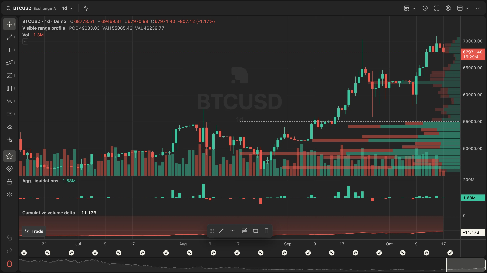
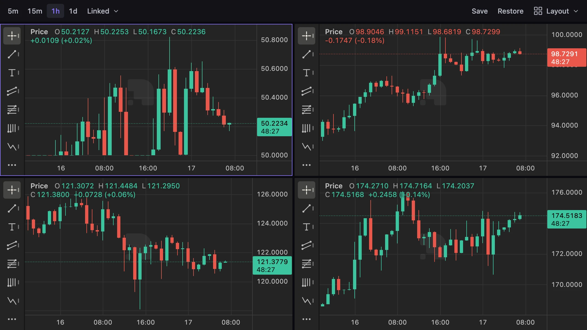
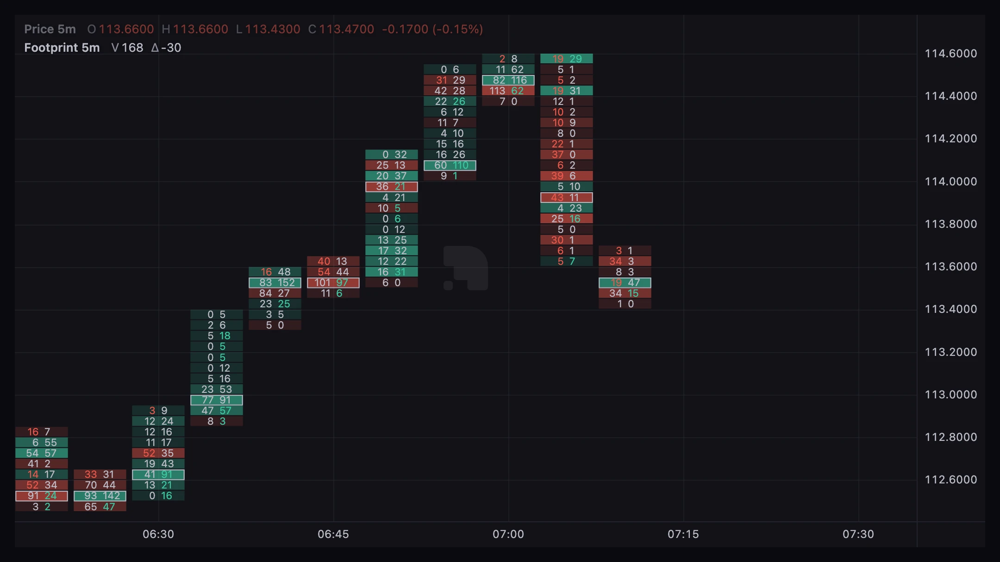
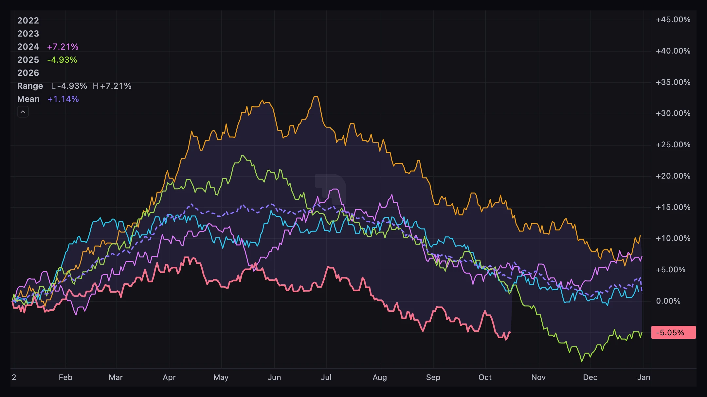
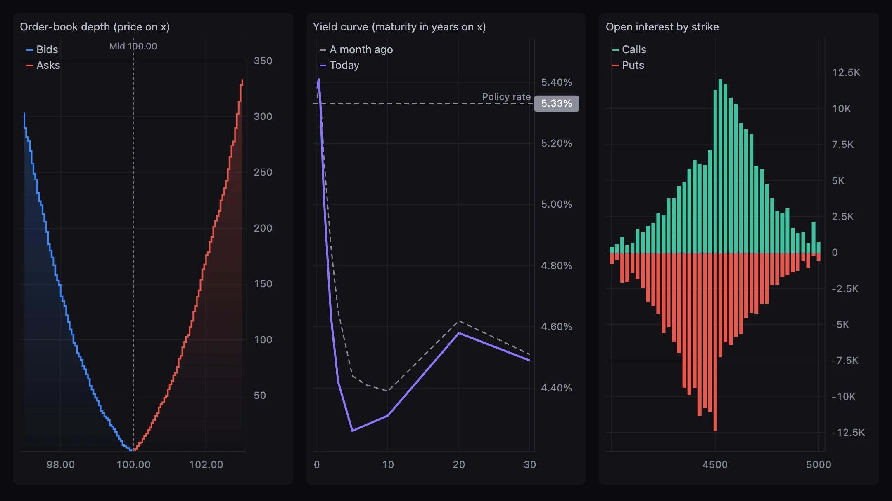

<div align="center">


# charton

**Fast, embeddable financial charts for the web.**

Candles, heatmaps, order flow, indicators and drawing tools, drawn with WebGL2.<br>
Use the engine with your own UI, or add the ready-made one. Written in TypeScript.

[](https://github.com/chart-on/charton/actions/workflows/ci.yml)
[](LICENSE)
[](#status-and-install)
[](tsconfig.base.json)
[](#why-it-stays-smooth)
[](packages/core/package.json)
[](CONTRIBUTING.md)

<!-- TODO(#725): add npm version and bundle size badges for @charton/core and @charton/ui once 0.1.0 is published. -->

[Getting started](docs/guide/getting-started.md) ·
[Guides](docs/guide/) ·
[Examples](docs/examples/) ·
[Changelog](CHANGELOG.md) ·
[Contributing](CONTRIBUTING.md)

</div>

<br>

<picture>
  <source media="(prefers-color-scheme: dark)" srcset="docs/public/readme/hero-dark.webp">
  <source media="(prefers-color-scheme: light)" srcset="docs/public/readme/hero-light.webp">
  
</picture>

<p align="center"><sub>The demo app (<code>pnpm dev</code>) with synthetic data. It follows the system colour scheme, and so does this picture.</sub></p>

## Highlights

- **Fast on the GPU.** Candles, bars, histograms, heatmaps and volume profiles are drawn with WebGL2. Your data goes to the GPU once, and panning or zooming never uploads it again, so long histories stay smooth.
- **Headless engine, optional UI.** `@charton/core` works with any UI and has no runtime dependencies. `@charton/ui` adds a toolbar, drawing rail, dialogs and themes, and small wrappers bring either one into component frameworks.
- **Built for trading.** Sixteen candle styles, liquidation and order-book heatmaps, volume profiles, footprint bars, multi-pane layouts, compared symbols, linked chart grids and charts with a numeric x-axis.
- **Indicators and drawings.** Ready-made indicators written as pure TypeScript functions, drawing tools with undo and redo, and plugin contracts for your own indicators, drawing tools and series.
- **Your data.** A data source API with generic REST, WebSocket, CSV and mock adapters, history paging and live updates.
- **Small by default.** Optional features are tree-shakeable plugins. A plain `createChart` bundle is under 100 KiB gzip, and CI checks a size budget for every bundle.
- **Accessible and international.** Keyboard and touch input, screen reader support and sonification, timezones, right-to-left layouts and opt-in translations in seven languages.

## Gallery

<table>
  <tr>
    <td width="50%"></td>
    <td width="50%"></td>
  </tr>
  <tr>
    <td align="center"><sub>Linked chart grid (<code>createChartGrid</code>)</sub></td>
    <td align="center"><sub>Footprint bars from trades</sub></td>
  </tr>
  <tr>
    <td width="50%"></td>
    <td width="50%"></td>
  </tr>
  <tr>
    <td align="center"><sub>Seasonality (<code>createSeasonality</code>)</sub></td>
    <td align="center"><sub>Numeric x-axis (<code>createNumericChart</code>)</sub></td>
  </tr>
</table>

## Contents

- **Start here:** [packages](#packages) · [how it fits together](#how-it-fits-together) · [status and install](#status-and-install) · [quick start](#quick-start)
- **A tour of the API:** [a full chart](#a-full-chart) · [indicators](#indicators) · [chart types](#chart-types) · [view and scale](#view-and-scale) · [the UI shell](#the-ui-shell) · [feature flags](#feature-flags) · [drawings](#drawings) · [custom drawing tools](#custom-drawing-tools) · [annotations](#annotations) · [styling](#styling)
- **Under the hood:** [why it stays smooth](#why-it-stays-smooth) · [requirements and limits](#requirements-and-limits)
- **Project:** [develop](#develop) · [documentation](#documentation) · [contributing](#contributing) · [security](#security) · [license](#license)

## Packages

Pick the pieces you need. Each package ships its own TypeScript types.

| Package | What it gives you |
| --- | --- |
| `@charton/core` | The chart engine: series, panes, scales, pan and zoom, crosshair and legend, with data sources, indicators and drawings as plugins. Works with any UI, or none. |
| `@charton/ui` | A ready-made chart app around the engine: toolbar, drawing rail, bottom bar, dialogs, and dark and light themes ([guide](docs/guide/ui-shell.md)). |
| `@charton/indicators` | Ready-made indicators, from moving averages and bands to oscillators and Ichimoku ([list](docs/guide/indicators.md#built-in-indicators)). |
| `@charton/ta` | Technical-analysis maths over `Float64Array`, for writing your own indicators ([guide](docs/guide/technical-analysis.md)). |
| `@charton/locales` | The built-in text in seven languages. Import only the ones you use ([guide](docs/guide/localization.md)). |
| `@charton/react`, `@charton/vue`, `@charton/svelte` | Components that mount a chart or the shell in a component framework, with server rendering support ([guide](docs/guide/frameworks.md)). |

<details>
<summary><b>What each package contains, in detail</b></summary>

| Package | Contents |
| --- | --- |
| `@charton/core` | Framework-free engine: WebGL2 candles/bars/histograms/heatmaps/volume profiles, Canvas2D lines/axes/drawings, panes, normal/log/percent/indexed price scales, pan/zoom with inertia, eased view and autoscale animations, seasonality views (`createSeasonality`), drawing-tool plugins |
| `@charton/ui` | Vanilla TS shell: a minimal default toolbar (interval, chart style, indicators, price scale, settings, fullscreen), drawing-tool rail, an optional bottom bar (go to date, clock, scale menu, range presets), any item in either bar, symbol search dialog, schema-driven form and picker dialogs, menus, segmented tabs; dark and light themes via `--pc-*` CSS variables |
| `@charton/indicators` | Built-in indicators (SMA, EMA, Bollinger Bands, VWAP, RSI, MACD, volume MA, cumulative volume, Keltner and Donchian channels, Supertrend, Ichimoku, ATR, Stochastic, Stoch RSI, DMI/ADX, OBV, moon phases) as ready-made definitions |
| `@charton/ta` | Dependency-free technical-analysis helpers over `Float64Array` (averages, ATR, Bollinger Bands, Keltner and Donchian channels, RSI, MACD, stochastic, Stoch RSI, DMI/ADX, Supertrend, Ichimoku, VWAP, OBV, moon phase...) for indicator authors |
| `@charton/locales` | Opt-in translations of the `@charton/core` and `@charton/ui` built-in text, one entry per language, so a bundle holds only the languages it imports; applied through the `localization()` plugin of `@charton/core` ([guide](docs/guide/localization.md)) |
| `@charton/react` | Components and hooks that mount a core chart or a UI shell in apps built with a component-based UI framework, with server rendering support ([guide](docs/guide/component-wrapper.md)) |
| `@charton/vue` | Components and composables for apps built with a template-based component framework, with server rendering support ([guide](docs/guide/template-wrapper.md)) |
| `@charton/svelte` | Components, an action and context helpers for apps built with a compiler-based component framework, with server rendering support ([guide](docs/guide/compiled-wrapper.md)) |

</details>

## How it fits together

Start with the engine and add only what your app uses. A plain chart is small; data sources, indicators, drawings and the rest are plugins you opt into. The UI shell sits on top when you want a complete chart app without building one.

<details>
<summary><b>What ships in core, and what is opt-in</b></summary>

charton is an embeddable charting library first and an app-like widget second.

- **Core** (`@charton/core`): the rendering engine, panes and pane layout, candles and bar styles, line, area, histogram and baseline series, time and price scales with timezones, pan, zoom, crosshair, keyboard and touch input, theming, the legend, accessibility, and the plugin contracts. A minimal `createChart` ships only this.
- **Opt-in core exports**: the data source API with its generic adapters (REST, WebSocket, CSV, mock), saved layouts (`layouts()`), bar grouping (`grouping()`) and the built-in plugins for indicators, drawings, compare and annotations.
- **`@charton/ui`**: a thin, replaceable shell on top: toolbar, drawing rail, indicator picker and settings dialog.
- **Add-ons**: everything else, such as trading lines, market depth, bar replay, sonification, seasonality, app chrome (symbol search, command palette, favourites), extra series and scales, and indicators and drawing tools beyond the built-in set. Each is a tree-shakeable plugin, a subpath entry or a separate package, and adds nothing to a minimal chart.

Some add-on code still ships in the default bundles while it moves out. The full lists and the rules for add-ons are in the [design principles](roadmap/design-principles.md#scope).

</details>

## Status and install

> [!NOTE]
> charton is pre-1.0 and not on npm yet. Until the first release, build the packages from this repository (see [Develop](#develop)). The API can still change between minor releases ([versioning](docs/guide/versioning.md)); the [upgrading guide](docs/upgrading/index.md) lists every change.

<!-- TODO(#725): add the install lines (pnpm add @charton/core, @charton/ui and the others) once the npm scope is claimed and 0.1.0 is published, and drop the note above. -->

Want to see it first? `pnpm install && pnpm dev` runs the demo app (`apps/demo`) at http://localhost:5173: synthetic data, every chart type, a volume overlay, a liquidation heatmap, liquidation and delta panes, and live ticks.

## Quick start

A candle chart with the engine alone:

```ts
import { createChart } from '@charton/core';

const chart = createChart(document.getElementById('chart')!);
const candles = chart.addCandles({ title: 'BTC' });

candles.setData(bars); // [{ time (unix seconds), open, high, low, close, volume? }]
chart.fitContent();
```

The same chart with the shell's default toolbar and drawing rail:

```ts
import { createChartShell } from '@charton/ui';
import '@charton/ui/style.css';

const { chart } = createChartShell(document.getElementById('chart')!);
chart.addCandles({ title: 'BTC' }).setData(bars);
```

Give the element a size; the chart fills it and follows it when it resizes. From here, the [getting started guide](docs/guide/getting-started.md) walks through the rest, and [`docs/examples`](docs/examples/) has a small runnable file for each feature.

## A tour of the API

Each part below shows one area in a few lines and links to its guide for the full story.

### A full chart

A shell with an interval switcher, volume, a liquidation heatmap, a volume profile and a delta pane. The comments explain each line.

```ts
import { createChartShell, type ToolbarItem } from '@charton/ui';
import '@charton/ui/style.css';

const toolbar: ToolbarItem[] = [
  {
    type: 'segmented', id: 'interval', label: 'Interval', value: '1h',
    options: ['1m', '5m', '1h', '1d'].map((v) => ({ value: v, label: v })),
    onChange: (interval) => loadData(interval),
  },
  { type: 'spacer' },
];

const { chart } = createChartShell(el, { toolbar }); // rail defaults to built-in tools

const candles = chart.addCandles({ title: 'BTC' });   // first candle series defines the time axis
const volume = chart.addHistogram({ title: 'Vol', overlay: { top: 0.8, bottom: 0 } }); // own scale, bottom 20%
const heat = chart.addHeatmap({ title: 'Liquidations' });
const profile = chart.addVolumeProfile();            // volume by price for the bars on screen; { range: 'session' } for one per day
const pane = chart.addPane({ stretch: 0.25 });
const cvd = chart.addLine({ title: 'CVD', area: true, baseline: 0 }, pane);

candles.setData(bars);               // { time (unix s), open, high, low, close, volume?, buyVolume? }
heat.setData({ times, priceStart, priceStep, rows, values }); // column-major Float32Array
candles.update(lastBar);             // replace or append
heat.updateColumn(time, column);

chart.on('history:request', ({ before }) => prependOlderBars(before));
chart.on('drawings:change', () => save(chart.drawings.serialize()));
```

**Bringing your own UI?** Use `createChart(el, options)` from `@charton/core`. A plain chart leaves out data sources, indicators, compared symbols, annotations, drawings, heatmaps and volume profiles, so it ships without their code. Add the plugins you need, or pass `createChart(el, { plugins: builtins() })` to get them all, as the shell does.

### Indicators

Register the ready-made indicators from `@charton/indicators`, then add them by id. Indicators need the `indicators()` plugin, which `builtins()` and the shell include.

```ts
import { builtinIndicators, rsiIndicator } from '@charton/indicators';

for (const def of builtinIndicators) chart.indicators.register(def);
chart.indicators.add('bbands');
chart.indicators.add(rsiIndicator, { length: 21 });
```

Writing your own is a plain object with declared inputs and outputs and a pure `compute` function ([indicators guide](docs/guide/indicators.md#writing-one)). To find one by name, `chart.indicators.search(query)` ranks the registered definitions the same way the indicator picker does; `matchRank` and `searchIndicators` do the same for any list ([indicator search](docs/guide/indicators.md#search)).

### Chart types

A candle series can be drawn in sixteen styles. Switch with `candles.applyOptions({ style })`:

`candles`, `hollow`, `volumeCandles`, `bars`, `heikinAshi`, `hlcBars`, `rangeBand`, `highLow`, `baseline`, `columns`, `area`, `line`, `lineMarkers`, `step`, `kagi` and `pointFigure`.

`kagi` and `pointFigure` draw bars built with `PriceBarBuilder` and need the `priceStyles()` plugin (or `builtins()`); see [price-based bars](docs/guide/series.md#price-based-bars).

To change the colours, use `upColor` / `downColor`, `upWickColor` / `downWickColor`, `upBorderColor` / `downBorderColor` and `colorByPreviousClose`. `thinBars: false` makes `bars` and `hlcBars` thicker as you zoom in.

### View and scale

Move the view and change the price scale from code. View changes animate; pass `false` to jump.

```ts
chart.scrollToRealtime();                    // animated; pass false to jump
chart.fitContent();
chart.setVisibleTimeRange(from, to);         // unix seconds
chart.resetView();                           // also Shift+End
chart.setPriceScaleMode('log');              // 'normal' | 'log' | 'percent' | 'indexed', per pane (default 0)
chart.setAutoScale(true);
chart.on('scale:change', ({ pane, mode, autoScale }) => syncButtons());
```

More in the [view and scale guide](docs/guide/view-and-scale.md).

### The UI shell

`createChartShell` wraps a chart in a toolbar, a drawing rail and a bottom bar. Pick a theme, and add only the parts your app needs.

```ts
const shell = createChartShell(el, { theme: 'light', bottomBar: { onRange } });
shell.setTheme('system'); // or 'dark' | 'light'
```

- **Colours** come from CSS variables on `.pc-shell` (`--pc-chart-bg`, `--pc-up`, ...). `themeFromCss(el)` reads them for a chart without the shell.
- **Optional parts** ship no code until you pass them: `symbolSearch()`, `commandPalette()`, `favorites()`, `toasts()`, `toolbarCustomization()`, `draftEditor()`, `clusterList()` and `replayControls()` ([optional parts](docs/guide/ui-shell.md#optional-parts)).
- **Symbol search**: `createChartShell(el, { symbolSearch: symbolSearch({ source, onSelect }) })`. Users open it with `/` or by typing on the chart, and you can call `shell.symbolSearch.open()` ([symbol search guide](docs/guide/symbol-search.md)).
- **Command palette**: with `commandPalette: commandPalette()`, Ctrl/Cmd+K opens a fuzzy search over every command on `chart.actions`, plus app sources such as symbols.
- **Favourites**: with `favorites: favorites({ tools })`, users star drawing tools in the rail's flyouts, and the starred ones sit in a movable bar over the plot. `shell.favorites.of(kind)` keeps favourites of other kinds too, such as intervals or symbols. They are saved to `localStorage` ([favourite tools](docs/guide/ui-shell.md#favourite-tools)).
- **Toolbar customization**: `toolbar: { items, customize: toolbarCustomization({ locked: ['symbol', 'interval'] }) }` lets users add, remove and reorder toolbar buttons from the More menu or a right-click, and remembers their choice. Apps add buttons to the catalog with `toolbar.registerAction(...)` and listen with `toolbar.on('change', ({ ids }) => ...)` ([end-user customization](docs/guide/ui-shell.md#end-user-customization)).
- **Chart settings**: a settings dialog (symbol colours, wicks and borders, legend, scales, canvas, events, time) generated from `chartSettingsSchema` in `@charton/core`. Open it with `shell.settings.open()` or a `settingsToolbarItem()`, and change its sections with `settings: { sections }` ([chart settings](docs/guide/ui-shell.md#chart-settings)).
- **Several charts**: `createChartGrid(el, { layout: '2x2', setup })` lays out one to eight linked shells in resizable cells, with a toolbar that acts on the active chart ([chart grid guide](docs/guide/chart-grid.md)).

### Feature flags

Switch built-in UI and input on or off, at creation or at runtime. Flags you leave out keep their value.

```ts
const chart = createChart(el, { features: { legend: false, zoom: false } });
chart.applyOptions({ features: { lastValueLabels: false, keyboard: false } });

shell.applyFeatures({ rail: false, bottomBar: false });   // shell parts, hidden in place
```

<details>
<summary><b>All flags</b></summary>

Chart flags:

| Flag | Default | Controls |
| --- | --- | --- |
| `legend` | on | Series values in a corner of each pane |
| `legendButtons` | on | Show/hide, settings and remove buttons on each legend row |
| `lastValueLabels` | on | Last-value labels on the price axis and the dotted last-price line |
| `countdown` | on | Time left in the current bar, under the last price label. Needs the `countdown()` plugin |
| `contextMenu` | on | The right-click menu |
| `watermark` | off | The symbol and interval behind the series |
| `plusButton` | on | The "+" button by the crosshair price label |
| `scroll` | on | Dragging, horizontal wheel and arrow-key scrolling |
| `zoom` | on | Wheel, pinch and `+` / `-` zoom |
| `axisDragScale` | on | Dragging the price or time axis to scale it |
| `keyboard` | on | Every keyboard shortcut |
| `touchScroll` | on | One-finger drag on touch screens |
| `touchZoom` | on | Two-finger pinch on touch screens |
| `sketch` | off | Hold, then draw a stroke that becomes a drawing |

Shell flags: `toolbar`, `rail`, `bottomBar`, `tooltip`, `railSheet` and `commandPalette`. The [feature flags guide](docs/guide/features.md) has the details and the flags that depend on each other.

</details>

### Drawings

Users draw with the rail; your app saves, loads and undoes. On a focused chart, Ctrl/Cmd+Z undoes and Ctrl/Cmd+Shift+Z or Ctrl+Y redoes, and the default rail has Undo and Redo buttons.

```ts
chart.drawings.undo();                       // false when there is nothing to undo
chart.drawings.redo();
chart.on('history:change', ({ canUndo, canRedo }) => syncButtons(canUndo, canRedo));
```

<details>
<summary><b>Undo history, saving and loading, per-interval drawings</b></summary>

Drawing creation, moves, text, style and lock edits, deletes and `clear()` are undoable; a drag is one step. History keeps the last 100 steps; `chart.drawings.load(data)` starts a fresh one.

`load()` is tolerant: it returns `{ loaded, errors }`, skipping malformed drawings and dropping ill-typed fields while loading the rest, and reports the problems through `drawings:invalid`. Older or app-specific formats go through the `chart.drawings.migrate` hook.

```ts
const { loaded, errors } = chart.drawings.load(saved);
chart.on('drawings:invalid', ({ errors }) => console.warn(errors)); // [{ index, field?, reason }]
chart.drawings.migrate = (data, fromVersion) => upgradeMyFormat(data, fromVersion);
```

A drawing can be limited to some bar intervals, such as only 1 to 15 minute charts: `chart.drawings.setVisibleOn(id, [{ from: '1m', to: '15m' }])`. Elsewhere it is not drawn or selectable; the ranges are saved with the drawing.

</details>

### Custom drawing tools

Besides lines, shapes and text, the rail's Patterns flyout has six chart patterns and five wave-count tools, all placed and edited anchor by anchor ([drawing catalog](docs/guide/drawings.md#built-in-tools)). To add your own tool, register it with a `render` and a `hitTest`:

```ts
chart.drawings.register({
  type: 'price-band', label: 'Price band', points: 2,
  render(ctx, d, env) { /* d.points are pane-local px; d.drawing.points are time/price */ },
  hitTest(d, p, env) { return false; },
});
chart.drawings.setTool('price-band');
```

Add it to the rail with `{ type: 'tool', tool: 'price-band', icon: MyIcon }`.

A tool goes back to the cursor after one drawing. `setTool(type, { keep: true })` keeps it for repeated drawings until the user leaves it (`drawings.toolKept`); in the shell, a double-click, double-tap or Shift+Enter on a tool does the same ([activate a tool](docs/guide/drawings.md#activate-a-tool)).

### Annotations

Markers and lines that your app adds from code. Unlike drawings, users don't create them, and they are not saved or undoable. They need the `annotations()` plugin, and trade lines also need `trading()`; `builtins()` and the shell include both.

```ts
chart.annotations.setMarkers([{ time, shape: 'arrow-up', text: 'B' }]); // stacked per bar
const alert = chart.annotations.addPriceLine({ price: 68250, title: 'Alert' });
const order = chart.annotations.addTradeLine({
  kind: 'order', price: 64000, side: 'buy', quantity: 0.5, takeProfit: 66000, stopLoss: 63000,
  onChange: ({ part, price }) => modifyOrder(part, price), // dragging is opt-in
  onAction: ({ action, part }) => cancelOrder(part),       // so are the buttons (default: cancel)
});
chart.annotations.addTradeLine({ kind: 'position', price: 63500, side: 'buy', quantity: 0.25, actions: ['close'], onAction: closePosition });
```

More in the [annotations guide](docs/guide/annotations.md).

### Styling

- **Chart colours**: `createChart(el, { theme: { up, down, heatmap: [...], ... } })` or `chart.applyOptions({ theme })`.
- **Toolbar and rail**: override the `--pc-*` CSS variables on `.pc-shell` (see `packages/ui/src/style.css`).
- **Chart root**: the size, background and touch handling of `.pc-chart` come from a zero-specificity rule, so your CSS overrides them without `!important`.
- **Icons**: any `icon` takes SVG markup, an `SVGElement`, an `IconNode` (`[tag, attrs]` pairs, the form of the built-in icons), or a function returning an element.

The [theming guide](docs/guide/theming.md) covers the built-in themes, fonts, the grid and colours from CSS.

## Why it stays smooth

Your data goes to the GPU once. Panning and zooming change only a few numbers in the shaders, the crosshair and drawings repaint on their own layer, and animations respect `prefers-reduced-motion`.

<details>
<summary><b>The techniques, in detail</b></summary>

- Data is uploaded to the GPU once (instanced rects, R32F heatmap texture); pan/zoom only change two affine uniforms per axis.
- Only visible instances are drawn (attribute offset trick in place of base-instance).
- Prices are stored relative to a per-series base to keep float32 precision.
- Crosshair/drawing moves repaint only the 2D overlay; scene repaints coalesce to one `requestAnimationFrame`.
- Line series decimate to first/min/max/last per pixel column.
- Inertial panning and eased wheel zoom; WebGL layer DPR capped (`maxGlDpr`, default 2).
- Autoscale eases towards its target, the forming bar tweens between ticks, and programmatic view changes (scroll to latest, fit, range presets) animate; all respect `prefers-reduced-motion` and can be disabled (`smoothScale`, `animateViewChanges`, series `animate`).
- Log scale is applied in the shaders, so switching modes costs no data re-upload.

The [performance guide](docs/guide/performance.md) adds tips for live data, a low-power mode and profiling.

</details>

## Requirements and limits

- **WebGL2.** Every current desktop and mobile browser has it, and there is no fallback renderer. Call `isWebGL2Supported()` first if you want to show your own message. The minimum browser versions are under [requirements](docs/guide/getting-started.md#requirements-and-failure-modes) and in each package's `browserslist` field.
- **Node.js** is needed only for tooling and tests.
- **Heatmaps**: columns must line up with consecutive main-series bars, and a heatmap keeps at most as many columns as the GPU's maximum texture size; the oldest are dropped.
- **Time zone**: axis labels use the viewer's local time zone unless you set the `timezone` option, for example to `'UTC'`.

## Develop

You need Node.js 22 or later and pnpm (the version is pinned in `package.json`).

```bash
pnpm install
pnpm dev        # demo at http://localhost:5173
pnpm test       # vitest
pnpm typecheck
pnpm build
pnpm api:check  # public API report
pnpm size       # gzip size of each bundle against its budget
pnpm docs:dev   # documentation site
```

## Documentation

The guides live in [`docs/guide`](docs/guide/) and the runnable examples in [`docs/examples`](docs/examples/). Good places to start:

- [Getting started](docs/guide/getting-started.md): your first chart, live updates, clean-up and requirements.
- [Concepts](docs/guide/concepts.md): the few rules behind everything else, such as unix-second times and the main series.
- Building blocks: [series](docs/guide/series.md), [data sources](docs/guide/data-sources.md), [indicators](docs/guide/indicators.md), [drawings](docs/guide/drawings.md), [annotations](docs/guide/annotations.md) and [the UI shell](docs/guide/ui-shell.md).
- Making it yours: [theming](docs/guide/theming.md), [localization](docs/guide/localization.md), [accessibility](docs/guide/accessibility.md) and [frameworks](docs/guide/frameworks.md).
- [Testing](docs/guide/testing.md): `@charton/core/testing` gives you deterministic sample data, frame control and scene snapshots for your own tests.
- [Upgrading](docs/upgrading/index.md): every API change between releases.
- [Versioning](docs/guide/versioning.md): what each release can change, and keeping every `@charton/*` package on one version.

<!-- TODO(#719): link the published docs site once it is deployed. -->

## Contributing

Contributions are welcome. Every change starts from a GitHub issue: claim it, branch as `feat/<issue>-short-name`, and open one pull request per issue with `Closes #<issue>`. [`CONTRIBUTING.md`](CONTRIBUTING.md) explains the workflow, setup and conventions, and AI coding agents follow [`AGENTS.md`](AGENTS.md).

New to the code? Start with an issue labelled [good first issue](https://github.com/chart-on/charton/issues?q=is%3Aissue+is%3Aopen+label%3A%22good+first+issue%22) or [help wanted](https://github.com/chart-on/charton/issues?q=is%3Aissue+is%3Aopen+label%3A%22help+wanted%22).

Everyone taking part follows the [code of conduct](CODE_OF_CONDUCT.md). Usage questions go to Discussions rather than issues; see [`SUPPORT.md`](SUPPORT.md). Thanks to [everyone who has contributed](https://github.com/chart-on/charton/graphs/contributors).

## Security

Please report vulnerabilities privately through the repository's private vulnerability reporting, never in a public issue. [`SECURITY.md`](SECURITY.md) lists the supported versions and response targets.

## License

[Apache License 2.0](LICENSE). See [`NOTICE`](NOTICE) for attribution.
